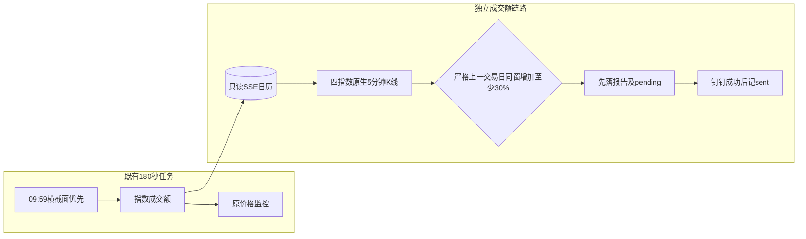

# 四指数5/15分钟成交额同比监控

## 方案结论

2026-11-17按用户“敏感一点”调整门槛50%→30%，再按用户指定将周期15/30分钟改为5/15分钟。规则标识为`index-volume-growth-30pct-5m-15m`，沿用按指数/窗口/周期去重。收盘后核对三账本pending为空再更新，账本历史不改写，不补发旧窗口。

长期监控上证指数、深证成指、创业板指、科创50，固定完成的5分钟和15分钟区间成交额，相比**严格上一交易日同时间段增加至少30%**时推钉钉。两个周期独立去重；无命中保持安静。复用现有180秒盘中任务，不新增调度。

`DEFAULT_INDEX_VOLUME_RULES`是实际运行启用门禁，清空后不取数、不发送pending、不改账本；当前仅接受一份`IndexVolumeRule`配置（默认5/15分钟，30分钟仅供原10点环境证据计算），其`codes/periods/growth_pct`真正控制执行，非法或多份配置失败关闭。调整判定含义须使用新`rule_id`（事件去重身份含rule_id），避免继承旧命中状态；目标提交仍须通过三账本pending切换保护。

## 背景与目标

用户确认“与昨日同时间段比较”，不是环比上一段、不是当日累计、不是成交量。5分钟和15分钟同时保留，长期有效直至下线。

## 范围与非目标

| 指数 | 唯一身份 | 东方财富secid |
|---|---|---|
| 上证指数 | `000001.SH` | `1.000001` |
| 深证成指 | `399001.SZ` | `0.399001` |
| 创业板指 | `399006.SZ` | `0.399006` |
| 科创50 | `000688.SH` | `1.000688` |

指数成交额口径可能重叠，不相加冒充全市场成交额。不是买卖建议，不写SQLite、持仓、关注池或计划层；不改变已有个股价格/均线规则和09:59横截面补扫。

## 现状与约束

现有`intraday-summary`仅滚动保存全市场快照，不保存昨日每个15分钟槽位，且依赖全市场覆盖门。因此本功能不使用其累计额差分或最近快照冒充同窗历史。

## 方案设计

东方财富`push2his.eastmoney.com/api/qt/stock/kline/get`，`klt=5,fqt=0,lmt=128`，字段`f51..f57`，128根足以覆盖两个完整开放日所需的96根5分钟K线。Provider新增可选`period_minutes=5`，不传仍返回15分钟以兼容旧调用。严格核验回包代码/名称/市场、7列格式、OHLC、时间升序唯一及收盘网格。成交额原值为十进制字符串（元），不缩放；15分钟为同一交易时段内相邻三根5分钟合计。每个指数独立有界请求，4个worker，每次连接2秒/读取3秒、最多2次请求；源失败不替换为其他指数。

只读SSE日历必须确认今天开放及严格前一开放日，前日至今天的自然日日历完整。缺日历`blocked_calendar`；缺任一根同窗行情或昨日基数为0均`source_failed/partial`，不得补0、除零或用最近有数据的一天替代。精确比较`当日金额×100 >= 昨日金额×130`，不以展示百分比四舍五入判断。



窗口收盘后延迟1～5分钟允许检查（含边界），取数后、发送前均重新检查当前窗口；过期不补发。5分钟收盘标签上午09:35至11:30、下午13:05至15:00；15分钟收盘标签上午09:45至11:30、下午13:15至15:00，不跨午休。例如09:38比较09:30～09:35，10:03同时比较09:55～10:00和09:45～10:00，11:33与15:03可评估收盘窗口。任务仍每180秒检查一次，不等待30分钟。

runner上午放行至11:35，既有价格服务的原时段守卫不变；下午既有15:05宽限不变。Mac休眠/断网或错过窗口不补发陈旧提醒，无覆盖保证。

## 数据模型

无DB/schema变更。新增独立`data/runs/intraday-monitor/index-volume-state.json`，kind=`index-volume`，不改原两份账本。

| 字段名 | 类型 | 必填 | 默认值 | 说明 |
|---|---|---|---|---|
| checked_event_ids | array | 否 | [] | 已成功算完的指数/日期/窗口/周期，未命中也去重 |
| pending_events | array | 是 | [] | 已落报告的命中事件及金额、来源、日期、有效窗口 |
| sent_event_ids | array | 是 | [] | 钉钉确认成功的事件 |
| expired_event_ids | array | 是 | [] | 超过窗口的待发事件，不补推 |
| last_attempt | object | 否 | 无 | 请求者、时间、状态、唯一报告路径 |

报告位于`data/reports/index-volume-monitor/YYYY-MM-DD/HHMM-<attempt>.json`，包含每项计算、来源和缺口。报告和状态同目录原子写、权限0600、跨进程锁；账本历史有界4096个ID，约覆盖16个完整交易日。来源/推送失败保留真实状态，失败可在当前窗口重试，成功项不重新抓取。原价位和横截面状态保持兼容。

## API设计

无HTTP入口。标准CLI复用`python3 scripts/main.py intraday-monitor check --input-by USER --json`；`--dry-run`不落盘不推送，自动runner显式`--input-by launchd`。兼容旧人工调用默认USER；空请求者在取数及写盘前拒绝。JSON增加`index_volume_monitor`分项，新增失败不吞掉旧价格检查，来源/推送失败传递到非零退出状态。`e2e-test`仍仅用于已有单标的规则，不假称本功能的真实链路验证。

## 实施计划

1. Provider与纯计算、独立状态/outbox及统一入口作为紧耦合单元实现。
2. 用临时SQLite、合成K线和模拟推送覆盖数据、业务、CLI、调度、切换guard。
3. 定向及全量后端测试通过后，两名会话内独立审查者检查正确性和契约/副作用；修后复测，完成后commit/合并main/push及runtime回读。

## 测试与验证

先`python3 -m pytest scripts/tests/test_index_volume_monitor.py scripts/tests/test_eastmoney_provider.py -q`，再已有`test_intraday_monitor_*.py`和`test_cli_smoke.py`。覆盖金额精确30%边界、零基数/缺根、午休、休市/日历缺口、延迟、去重/失败重试、陈旧pending、损坏账本、dry-run无写和异常隔离。最终`make check-scripts`、`make commands-check`、`git diff --check`均通过才发布；全量测试隔离真实凭据和推送。

真实数据仅只读验证身份、单位与同窗算术，收盘后历史probe不等于盘中实时覆盖或钉钉送达。未授权不发送测试消息。

## 风险与回滚

| 风险 | 处理 |
|---|---|
| 源布局/名称/单位变更、源延迟 | 严格契约失败关闭，缺源保留失败，不能假报未命中 |
| 推送失败 | pending只在当前1～5分钟窗口重试，过期不补发 |
| 切换/回滚丢pending | 停止任务后用新guard同时核对三份状态，目标提交须认识所有pending规则 |
| 发送成功但本地回执落盘失败 | 无跨系统事务，可能存在重复边界；不得声称绝对exactly-once |
| Mac休眠或错过窗口 | 无行情覆盖，不补陈旧告警；需要强保障另行迁移运行环境 |

兼容性：CLI旧参数和两个原账本保留；迁移方案：新账本按首次合格窗口创建，无SQL迁移；回滚策略：先停任务，三份账本逐个guard核验目标提交，未知pending禁止切换。切换前后SHA256/不存在状态保持一致，不能删除pending强行回滚。

## 待确认问题

无。本次按用户“敏感一点”的要求采用30%门槛；四指数、上一交易日同窗和长期运行范围沿用既有设置，周期按用户指定改为5/15分钟。

## 十点环境补充证据

2026-11-17：原10点环境窗口仍为09:30～10:00，改用六根5分钟K线合计；昨日六根、昨日15:00收盘一根、今日六根，共13根必要证据。版本`opening-environment-v2-5min`，与告警周期独立，不新增取数或推送。

2026-11-10 十点环境观察（出处 teacher_notes#1178）：既有指数成交额监控在10:01～10:05的已完成10:00半小时槽位复用原请求K线，逐指数记录高开、10点低于开盘、同窗成交量及成交额同比。近似平量±5%为工程观察定义，非课程给定阈值；四指数分别展示，不合并成全市场结论。只新增每次尝试JSON的`opening_environment`证据与中文解读，不入pending、不新增取数/调度/推送/业务写入，不改变三账本契约。缺源独立降级，金额已检查后环境缺口不单独重试，无记录不代表未命中；详见`docs/opening-environment.md`。

## 全天5分钟量价归档

每次既有四指数请求获得的同源东方财富5分钟K线，在原成交额任务完成后按日追加到共享数据目录 `data/reports/index-volume-monitor/ohlcv-5m/YYYY-MM-DD.json`。本次已闭合槽之后的数据不采用；同时保留已核验的上一开放日返回行，可补上当时因休眠等原因错过的槽位。不会为归档增加盘中请求。数据页按上海时间收盘标签，上午09:35—11:30、下午13:05—15:00，每指数48根，四个合计192根。每行保存OHLC、原生成交量、成交额（元）、实际采集时间与请求者。每半场六根连续、无冲突才能聚合成一根30分钟K。原始量不跨指数求和。

日档列出截至观察时点的缺口和全日有效覆盖。相同原值重跑幂等，不覆盖首次采集来源；不同原值在冲突表保留并停止该时间段的聚合。局部缺失不补零；旧文件哈希损坏时保留并在调用结果中报告错误。归档使用逐日文件锁与原子替换。没有旧档案的历史日期不表述为0根已核验。

手工只回收一个已收盘开放日时，从此运行工作目录调用 `python3 scripts/tools/index_bar_archive.py --date YYYY-MM-DD --input-by USER`。它先核对本地10点回执，再向同一东方财富5分钟源作有界取数；`--local-only`仅使用已有10点原值。只写请求日期，不启动提醒。源仅提供近期有限窗口，不能保证任意历史日全覆盖。缺口退出码为2。

## 实时覆盖与同源回退

以每个上海交易时段的 5 分钟收盘时刻为单位，按 `captured_at` 取当槽最后一次回执。每日 15:00 槽位的现有监控结果增加 `realtime_coverage`。只读复查可在本运行目录执行：

```bash
python3 scripts/tools/index_bar_archive.py --coverage --start-date 2026-11-23 --date 2026-11-27
```

输出包含逐日早盘、午后、逐槽状态、汇总及完整率。缺回执、无效回执计入分母；仍可继续检查的空槽单列等待。日历或目录无法核验的日期另列，完整率仅覆盖可核验日期。此口径自 11 月 18 日启用五分钟监控起适用。全天 OHLCV 日档可盘后补全，不能代替实时运行回执。

主源最多请求两次，分别记录 HTTP 状态、连接、超时、TLS 或 JSON 解码错误；回包结构异常单列。若网络请求失败或比较窗口缺根，可复用已通过哈希核验的同一东财日档。两事实日、同一指数、同一收盘时刻与人民币成交额均需匹配，且所用根在本次观察时已取得。当时已有的冲突、原值缺失或未来才取得的行保留缺口。每条使用日档的评估记录主源原因及实际采用根的事实日、取得时间和档案路径。盘后取得的历史数据不能补发实时提醒。新浪、通达信与主源的四指数同窗成交额尚缺可核验的对照样本，未接入实时降级。
