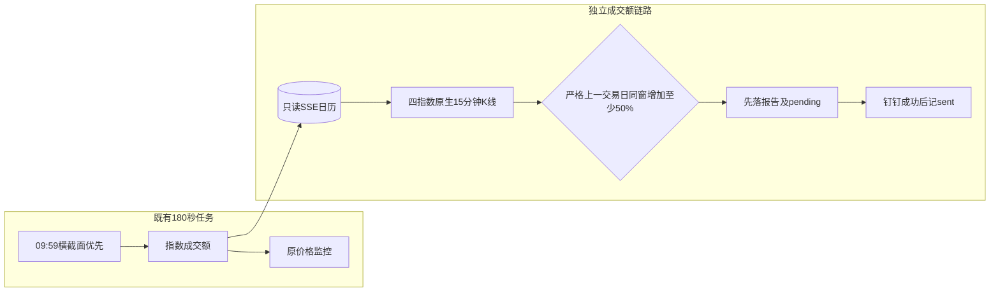

# 四指数15/30分钟成交额同比监控

## 方案结论

长期监控上证指数、深证成指、创业板指、科创50，固定完成的15分钟和30分钟区间成交额，相比**严格上一交易日同时间段增加至少50%**时推钉钉。两个周期独立去重；无命中保持安静。复用现有180秒盘中任务，不新增调度。

`DEFAULT_INDEX_VOLUME_RULES`是实际运行启用门禁，清空后不取数、不发送pending、不改账本；当前仅接受一份`IndexVolumeRule`配置，其`codes/periods/growth_pct`真正控制执行，非法或多份配置失败关闭。调整判定含义须使用新`rule_id`（事件去重身份含rule_id），避免继承旧命中状态；目标提交仍须通过三账本pending切换保护。

## 背景与目标

用户确认“与昨日同时间段比较”，不是环比上一段、不是当日累计、不是成交量。15分钟和30分钟同时保留，长期有效直至下线。

## 范围与非目标

| 指数 | 唯一身份 | 东方财富secid |
|---|---|---|
| 上证指数 | `000001.SH` | `1.000001` |
| 深证成指 | `399001.SZ` | `0.399001` |
| 创业板指 | `399006.SZ` | `0.399006` |
| 科创50 | `000688.SH` | `1.000688` |

指数成交额口径可能重叠，不相加冒充全市场成交额。不是买卖建议，不写SQLite、持仓、关注池或计划层；不改变已有个股价格/均线规则和09:59横截面补扫。

## 现状与约束

现有`intraday-summary`仅滚动保存全市场快照，不保存昨日每个15分钟槽位，且依赖全市场覆盖门。因此本功能不使用其累计额差分或最近快照冒充同窗历史。

## 方案设计

东方财富`push2his.eastmoney.com/api/qt/stock/kline/get`，`klt=15,fqt=0,lmt=128`，字段`f51..f57`，严格核验回包代码/名称/市场、7列格式、OHLC、时间升序唯一及收盘网格。成交额原值为十进制字符串（元），不缩放；30分钟为同一交易时段内相邻两根15分钟合计。每个指数独立有界请求，4个worker，每次连接2秒/读取3秒、最多2次请求；源失败不替换为其他指数。

只读SSE日历必须确认今天开放及严格前一开放日，前日至今天的自然日日历完整。缺日历`blocked_calendar`；缺任一根同窗行情或昨日基数为0均`source_failed/partial`，不得补0、除零或用最近有数据的一天替代。精确比较`当日金额×2 >= 昨日金额×3`，不以展示百分比四舍五入判断。

窗口收盘后延迟1～5分钟允许检查（含边界），取数后、发送前均重新检查当前窗口；过期不补发。15分钟收盘标签上午09:45至11:30、下午13:15至15:00；30分钟收盘标签10:00/10:30/11:00/11:30及13:30/14:00/14:30/15:00，不跨午休。例如09:48比较09:30～09:45，10:03同时比较09:45～10:00和09:30～10:00，11:33与15:03可评估收盘窗口。

runner上午放行至11:35，既有价格服务的原时段守卫不变；下午既有15:05宽限不变。Mac休眠/断网或错过窗口不补发陈旧提醒，无覆盖保证。

## 数据模型

无DB/schema变更。新增独立`data/runs/intraday-monitor/index-volume-state.json`，kind=`index-volume`，不改原两份账本。

| 字段名 | 类型 | 必填 | 默认值 | 说明 |
|---|---|---|---|---|
| checked_event_ids | array | 否 | [] | 已成功算完的指数/日期/窗口/周期，未命中也去重 |
| pending_events | array | 是 | [] | 已落报告的命中事件及金额、来源、日期、有效窗口 |
| sent_event_ids | array | 是 | [] | 钉钉确认成功的事件 |
| expired_event_ids | array | 是 | [] | 超过窗口的待发事件，不补推 |
| last_attempt | object | 否 | 无 | 请求者、时间、状态、唯一报告路径 |

报告位于`data/reports/index-volume-monitor/YYYY-MM-DD/HHMM-<attempt>.json`，包含每项计算、来源和缺口。报告和状态同目录原子写、权限0600、跨进程锁；账本历史有界4096个ID，约覆盖至少21个完整交易日。来源/推送失败保留真实状态，失败可在当前窗口重试，成功项不重新抓取。原价位和横截面状态保持兼容。

## API设计

无HTTP入口。标准CLI复用`python3 scripts/main.py intraday-monitor check --input-by USER --json`；`--dry-run`不落盘不推送，自动runner显式`--input-by launchd`。兼容旧人工调用默认USER；空请求者在取数及写盘前拒绝。JSON增加`index_volume_monitor`分项，新增失败不吞掉旧价格检查，来源/推送失败传递到非零退出状态。`e2e-test`仍仅用于已有单标的规则，不假称本功能的真实链路验证。

## 实施计划

1. Provider与纯计算、独立状态/outbox及统一入口作为紧耦合单元实现。
2. 用临时SQLite、合成K线和模拟推送覆盖数据、业务、CLI、调度、切换guard。
3. 定向及全量后端测试通过后，两名会话内独立审查者检查正确性和契约/副作用；修后复测，完成后commit/合并main/push及runtime回读。

## 测试与验证

先`python3 -m pytest scripts/tests/test_index_volume_monitor.py scripts/tests/test_eastmoney_provider.py -q`，再已有`test_intraday_monitor_*.py`和`test_cli_smoke.py`。覆盖金额精确50%边界、零基数/缺根、午休、休市/日历缺口、延迟、去重/失败重试、陈旧pending、损坏账本、dry-run无写和异常隔离。最终`make check-scripts`、`make commands-check`、`git diff --check`均通过才发布；全量测试隔离真实凭据和推送。

真实数据仅只读验证身份、单位与同窗算术，收盘后历史probe不等于盘中实时覆盖或钉钉送达。未授权不发送测试消息。

## 风险与回滚

| 风险 | 处理 |
|---|---|
| 源布局/名称/单位变更、源延迟 | 严格契约失败关闭，缺源保留失败，不能假报未命中 |
| 推送失败 | pending只在当前1～5分钟窗口重试，过期不补发 |
| 切换/回滚丢pending | 停止任务后用新guard同时核对三份状态，目标提交须认识所有pending规则 |
| 发送成功但本地回执落盘失败 | 无跨系统事务，可能存在重复边界；不得声称绝对exactly-once |
| Mac休眠或错过窗口 | 无行情覆盖，不补陈旧告警；需要强保障另行迁移运行环境 |

兼容性：CLI旧参数和两个原账本保留；迁移方案：新账本按首次合格窗口创建，无SQL迁移；回滚策略：先停任务，三份账本逐个guard核验目标提交，未知pending禁止切换。切换前后SHA256/不存在状态保持一致，不能删除pending强行回滚。

## 待确认问题

无，四指数、15/30分钟、上一交易日同窗、增加≥50%、长期均已确认。
