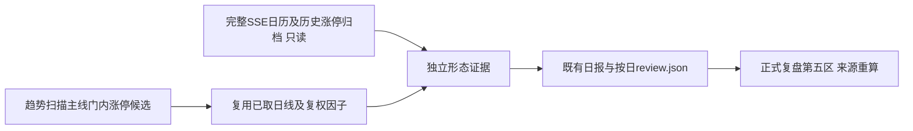

# 涨停回撤与再涨停证据

课程出处为用户提供的《10月31正课1》51:04—57:02；原文不是已绑定的老师笔记，不借用其他课程的 teacher_notes ID。本期把“涨停后回落、再涨停、穿多线”拆为事实，不判洗盘意图、斜面形态、龙头资格或胜率。

## 接入与边界

- 观察对象含被原首次加速/缓涨门拒绝的候选，避免“近期未加速”与“再次涨停”条件冲突；不是全市场普查，不把未进入本次扫描的股票报成未命中。
- 无新增外网请求、CLI、业务表、调度、独立推送、池字段、认知或计划写入。既有趋势日报推送中会包含新段落，遵守原有 `--no-push` 与 `--dry-run`。本次验证不实际执行落池或推送命令。
- 扫描完成后只读 `daily_market.raw_data.limit_up` 和 `trade_calendar`；不补历史名单、不使用当前题材成员代替历史。历史缺口只降级新块，原趋势池及旧回踩、财务证据继续按原规则运行。
- 原趋势快照没有 `limit_pullback` 时保持原样，表示该项未计算；不把缺失解释成零。新快照封存依据，读取时重算、拒绝汇总篡改，日报SHA校验仍生效。整体旧模块来源失败时，不单独复活新卡。

## 事实口径

1. 完整SSE日历锁定含观察日在内的20个开放日。20日与MA5/10/20/30是明确的工程窗口，不是课程给出的硬阈值。
2. 当前与历史涨停只认已支持来源的成功名单，核对返回日期、计数、代码唯一与非ST身份。历史取窗口内最近**已核验**涨停；缺归档时不能称最近实际涨停。AkShare只采用命中事实，不从名单缺席断言未涨停。
3. 复用本次扫描的Tushare日线与复权因子，检查请求身份、日期唯一/升序/目标日、完整因子、有限正价格与OHLC关系；保留尾部最多50根，不改变原检测器用窗。前复权用于跨日高低价及均线；当日低开相对行情自身 `pre_close`。
4. 单板锚点前一根有效K线收盘为回撤基准；锚点后、今日之前最低价用于是否回到基准、相对锚点最高价的回撤。没有中间K线不计算回撤；不合并此前双板的总涨幅。穿线严格按当日阳线实体开盘 < MA < 收盘，贴线不算穿线。
5. 展示日线OHLC一价、低开、穿过的均线、今日收盘相对锚点高点百分比；不预测目标价，不用综合“形态成立”分数代替这些事实。日线无法核验盘中封单持续性。
6. 既有主线门仅说明候选来源，不能证明课程所说的题材支持。没有新增题材强弱结论。

## 分层验证与完成条件

- 纯函数层：正常形态、复权除权、回看缺口、无历史锚点、无中间K线、未知来源、身份/日期/价格/因子异常及篡改均有隔离用例。
- 接入层：内存数据库验证只读归档；真实扫描服务配假provider验证未入池候选仍有证据、原输出和provider调用序列不变。
- 报告层：既有review快照往返及SHA核对、独立降级、正式HTML来源签名、来源篡改拒绝、桌面/手机展开验证。
- 完成标准：针对性测试与 `make check-scripts` 通过，命令索引和差异检查通过，会话内独立审查问题处置完成。历史市场结果须由实际扫描生成，合成测试预览不能冒充真实命中名单。

## 回滚

移除 scanner 的新缓存和collect接线、renderer段落与review_evidence可选块即可；不涉及迁移或业务数据清理。旧快照保持原样。

## 内部审查处置

第一轮6项中等问题均已修复并补测：按标准双写信封读取历史名单并校验日期、非法缺口结构仅降级新卡、已核验涨停日缺K线不能变成“未见”、核验显式交易所与因子身份、昨收与当日涨跌幅交叉复核、复权后再次检查有限正价格防止数值下溢。另补严格序列化保护，NaN/Inf或非法对象不影响旧快照写入；候选发现源失败时空列表保留缺口，不报为真实零样本。

2026-11-03 验证回执：修后针对性139项通过（新增模块46项）；当前工作树全量 `make check-scripts` 为7986通过、1跳过、21条警告，457.68秒，含其他已存在改动的测试。两名内部审查者第二轮均通过，无遗留严重/中等问题；命令索引与差异检查通过。合成卡在390px和1440px检查展开内容与横向溢出；不代表真实市场命中。未执行真实扫描落池、业务录入或消息推送，未提交/发布远端。

## main发布适配

远端main尚未采用本地其他任务的400日均线扩窗。本次不携带该改动：维持main既有90自然日日线窗口与在池对象复权请求，只复用当前扫描取得的行情与因子。未入池候选仍展示，但若main本次未取因子则明确source_failed；不隐式补采，也不把缺因子当成未出现形态。本地研发分支的139/7986测试记录不替代发布副本验证。

2026-11-03发布副本验证：针对性208通过；修后完整 `make check-scripts` 8759通过、1跳过、21条既有依赖警告，280.83秒。两名内部审查者第二轮通过；修复维护阶段重新取数的来源同步，并覆盖主源/降级源切换与原请求序列不变。命令索引、提交清单和差异格式检查通过。发布包含三期代码、测试、两份说明及用户要求的仅内部审查规则；不含400日扩窗或其他工作区改动。
