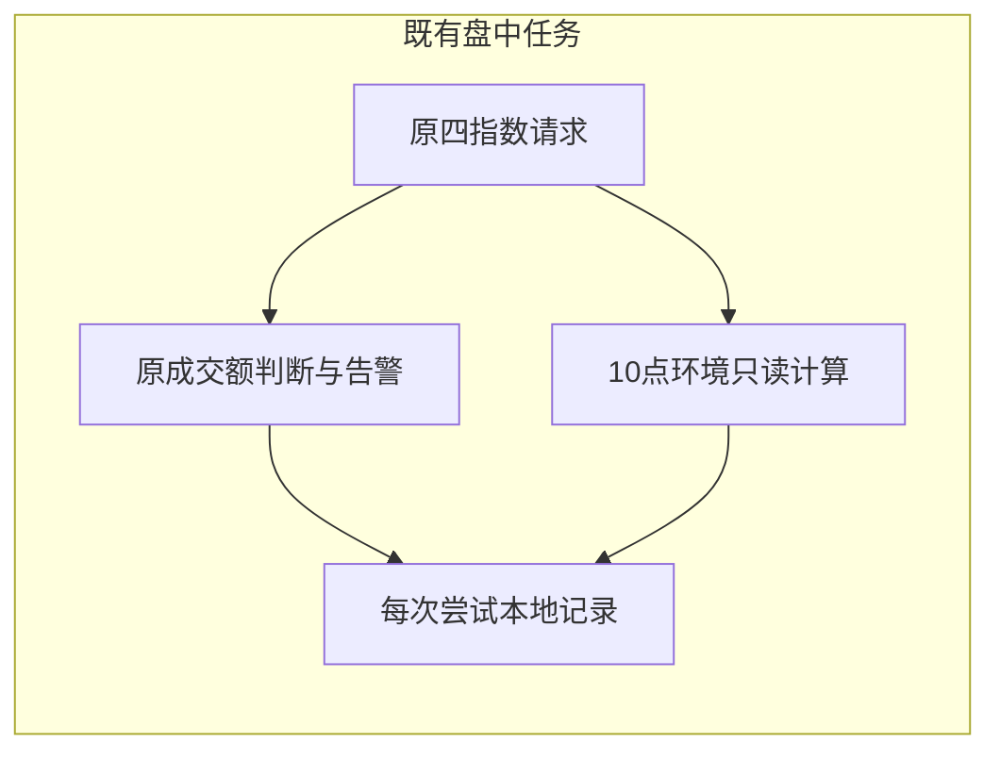

# 十点市场环境观察

## 方案结论

出处：鞠磊2026-11-10课程 `teacher_notes#1178`。复用现有四指数成交额任务取得的15分钟K线，在已完成10点半小时槽位增加本地环境证据；不生成交易指令，不新增告警。

课程以大盘为例，先看高开，再看10点低于开盘、前半小时成交量缩减或接近平量。本实现对上证、深证、创业板、科创50逐个观察，不推断统一市场状态。±5%是系统对“近似平量”的工程定义，课程没有给出这个阈值，效果尚未验证。

## 范围与时点

沿用原180秒任务；10:01～10:05（含边界）处理10:00已完成窗口。只读完整SSE日历确认严格上一开放日，不能以最近有行情日替代。收盘后不补记盘中观察；休眠或错过窗口不保证覆盖。

前一开放日09:45、10:00、15:00及当日09:45、10:00五根K线必须齐全。09:45条的开盘字段作为09:30开盘；10:00条收盘字段作为10点位置；昨日15:00条收盘作为昨收。不用10:03实时价格冒充10点。

## 口径

| 字段 | 类型 | 必填 | 默认值 | 含义 |
|---|---|---|---|---|
| high_open | boolean | 完整项是 | 无 | 开盘严格高于昨收，相等不成立 |
| below_open_at_1000 | boolean | 完整项是 | 无 | 10点严格低于开盘，相等不成立 |
| volume_growth_pct | 十进制字符串 | 完整项是 | 无 | 当日两根量之和相对昨日同窗增幅 |
| volume_state | string | 完整项是 | 无 | contracted：低于-5%；near_flat：-5%～+5%含边界；expanded：高于+5% |
| weak_environment_candidate | boolean | 完整项是 | 无 | 高开、10点低于开盘且成交量同比≤+5%同时成立，仅作[判断]观察 |
| amount_growth_pct | 十进制字符串 | 完整项是 | 无 | 成交额同比，独立背景，不代替成交量 |
| source_bars | array | 完整项是 | 无 | 五根必要原始字段，可重放计算 |
| status | string | 是 | 无 | complete / partial / source_failed / not_recomputed |
| input_by / captured_at | string | 是 | 无 | 复用标准CLI请求者及本次捕获时刻 |

成交量保留东方财富原生单位，只在同一指数、同源、同窗内比较；不换算或跨指数求和。成交额单位元。全部OHLC为正且关系有效、量额非负；昨日同窗量和额均须大于零。原监控校验身份、时间网格、重复行和金额，环境模块额外校验五根OHLC与量。任何缺口不补0，失败项不输出false冒充未命中。

未同时满足条件也不认定强势；不包含个股分时背离、买卖信号或效果回验。

## 集成与兼容

复用`intraday-monitor check --input-by USER --json`，新增可选结果字段`index_volume_monitor.opening_environment`，并写入原`data/reports/index-volume-monitor/YYYY-MM-DD/1000-<attempt>.json`，内含中文判断。无新CLI/API/DB/schema或调度；dry-run不落盘不推送。

环境失败仅影响自身状态，不抬高原成交额检查状态，也不阻挡原告警。每次尝试独立保存，不合并多次尝试的覆盖。未重新取数项标`not_recomputed`，查看先前尝试；不伪装成完整或空名单。原金额槽位已经成功后不为环境缺口单独取数或重试，告警推送重试亦不重复取数。首次记录不被后续尝试覆盖。

三份状态账本及pending不增加环境字段，不产生新推送事件。旧记录缺字段意味着未计算，不能当作未命中。迁移不适用；回滚本模块及service引用即可，不清除账本；若切换Git版本，仍须遵守原三账本guard。

## 实施与验证

1. 纯计算层：新增`test_opening_environment.py`，覆盖价格严格边界、成交量±5%精确边界、五根缺失、重复/错位/非法数据及源字段重放。
2. 服务层：临时日历/账本、合成行情和模拟推送，验证同一批四次请求、环境不产生推送、原八项告警兼容、重试独立记录、dry-run和超窗无写。
3. 原Provider及CLI回归：`python3 -m pytest scripts/tests/test_opening_environment.py scripts/tests/test_index_volume_monitor.py scripts/tests/test_eastmoney_provider.py scripts/tests/test_intraday_monitor*.py scripts/tests/test_cli_smoke.py -q`。
4. 完整后端：`make check-scripts`（含命令索引检查），`git diff --check`；不得出现新增失败或本功能警告。随后两名会话内独立审查者检查边界与集成副作用，发现实质问题修后重跑。
5. 比对三份实盘账本SHA，确认开发测试没有修改业务状态；测试不访问真实网络或发送真实消息。

真实盘中覆盖与交易效果未验证；完整性状态按每次实际尝试记录。待确认问题：无，本阶段只落实本地观察。

## 本次验收记录

2026-11-10：修后专项163项通过；修后`make check-scripts`完整后端9170项通过、1项跳过、21项既有依赖警告（305.50秒），命令索引检查通过。完整日志：`/private/tmp/opening-environment-full-check-final.log`。

两名会话内独立审查者完成两轮检查。第一轮发现轻微P3：极小十进制原值保存为科学计数法后无法重放；已统一定点格式保存价格、量、额，补三组最小精度测试。第二轮均通过，无遗留可操作问题。

三份实盘账本SHA与开发前一致；未调用真实盘中检查或发送真实测试消息。代码使用现用盘中运行目录；真实10点采集覆盖待下一交易日验证。
