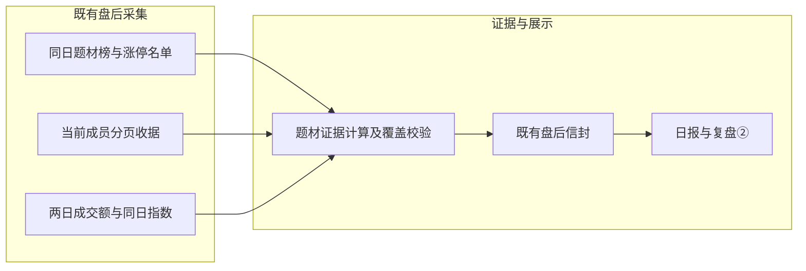
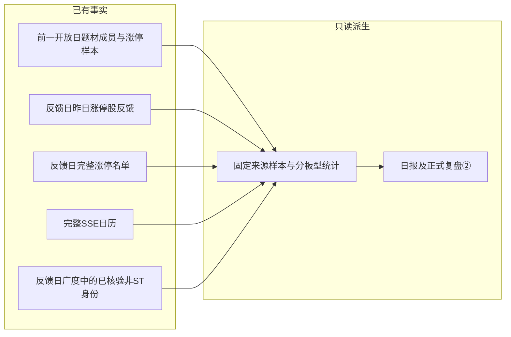

# 题材启动证据卡

出处：用户提供《10月31正课1》15:40—27:11、47:23—48:15。课程阈值属于老师观点，未绑定已入库笔记，不写认知、关注池或计划。

## 范围与来源

- 随既有 `MarketCollector.collect_post_market` 保存 `raw_data.theme_launch`，沿原盘后信封归档/双写，无新增业务表、CLI、调度或推送。正式复盘②只读显示；报告日、事实日、成员采集日分别保留。
- `limit_cpt_list` 按日期、唯一代码、连续排名校验，只取原榜前10个题材。题材榜可能包含泛概念，不代表主线或首次启动，不以申万行业替代。
- 新 `get_theme_member_snapshot` 能力独立于旧概念缓存，按题材代码请求 `ths_member`，显式请求 `is_new`，只采用Y；分页按实际返回行数推进，到空页闭合，最多10页×2000行。重复身份、未知状态、空成员、未闭合逐题材失败，不把部分结果当完整名单。
- 成员请求有120秒批次调度预算；单请求超时不超过15秒及剩余预算，不修改共享客户端配置。预算用尽后停止新增请求，已完成题材保留，其余逐题材失败；网络超时是连接/读取等待限制，不宣称绝对墙钟硬截止。
- 官方接口仅提供最新成员（[Tushare文档](https://tushare.pro/document/2?doc_id=261)）。只有上海当日16:00后、完整SSE日历确认开放日及严格上一开放日才采集；历史补跑只读取已存证据，旧归档未计算保留 `not_computed`。成员快照不声称盘中或历史时点成员。

## 事实口径

1. 当日已验证涨停名单与成员相交，按名称排除ST/退市/B股，10/20/30cm为常规板型。原榜自带涨停总数不代替重算，跨题材不可加总。真实空涨停名单与源失败分开。
2. 10cm身位证据：今日核验连板≥2、严格前日也在涨停名单、两日已核验板数恰好递增1；未知板数不默认首板，不判定龙头或相对领先。
3. 量价：题材涨跌直接保留同日榜单字段；指数使用已返回真实日期的上证/创业板日线，缺日期不猜。复用 `sector_increment` 逐股成交额并复核合计，按当前同一份成员集合比较两日。沪深成交额含ST、剔北交所/B股，与非ST涨停样本范围不同。
4. 任一沪深成员缺少两日成交额时，该题材增额不计算；全市场成交额为partial时不计算份额变化。增额不是净流入，不自动断言增量市场或存量集中。
5. 课程“10cm≥10”与“10/20cm合计≥10”分别展示原始计数，不硬编码顶级启动。新颖性、海外共振、20cm未涨停扩散、竞价封单变化暂未计算，不把这些项标为通过。

## 展示、兼容与验证

- 日报Markdown摘要与正式HTML同一计算/渲染来源。HTML②唯一 `data-theme-launch`，禁止chunk手写；校验全文来源签名、日期、位置、隐藏/重复及折叠证据预算。降级进入ops。
- 保存计算依据，读取时重新计算比对；已算值被改动、来源日期错位或结构损坏拒绝。休市日仅在完整日历核验后展示上一开放日，开放日缺源不回退。
- 指数同时核对代码、已核验来源及所有已出现日期字段的一致性；无证据失败信封移除夹带数值。成员快照日只有至少一个题材成员通过核验才显示，其他情况为“未取得”，部分成功按题材列覆盖。
- 无数据库迁移；新provider能力不改变旧成员方法。指数日线仅追加真实 `trade_date` 字段。回滚移除collector/generator/assembler接线及新增能力即可，旧信封不受影响。
- 数据层测试：分页/重复/有效状态/错日/失败隔离；计算层：板型、ST、两日身位、重叠概念、成交额缺口及原始证据重算；展示层：来源签名、HTML转义、注入拒绝和休市日期。测试外网隔离。
- 验证命令：`python3 -m pytest scripts/tests/test_theme_launch.py scripts/tests/test_daily_review_html_report.py scripts/tests/test_post_market_enhancements.py -q`；`make commands-check`；`make check-scripts`；会话内独立审查。所有本次新增失败必须解决；实际取数失败如实保留。

第一期为题材启动证据卡；第二期为下述同题材次日反馈。涨停挖坑形态证据仍是后续独立工作。

## 2026-11-02 验证记录

- 两名会话内独立审查者完成两轮审查并通过复核；中等问题（指数身份/日期/来源校验、失败信封夹带数值、整批成员采集预算）及轻微问题（缺失快照日期、入口测试仅检查文本）均已修复并补测。
- 修后专项测试43项通过，覆盖证据计算、成员采集、独立请求超时及正式HTML入口；`make commands-check`通过。最终 `make check-scripts`：7729通过、1跳过、21条环境/依赖警告，耗时549.82秒；这是共享工作区全量结果，包含其他并行改动的测试，不代表本功能新增了7729项。`git diff --check`通过。
- 只读实采预览位于 `data/reports/theme-launch/2026-11-02-preview.html` 和同名JSON。上游初始化返回502，10个题材成员均未核验，整体保留 `source_failed`、成员日期为空；未回写当日盘后归档。390px和1440px预览已检查。
- 外部原生审查此前被自动审批拒绝，未执行；随后用户于2026-11-02明确要求“以后内部审查就好了”。仓库规则已改为仅内部审查，本次两名内部审查者复核及修后测试均已通过，审查完成，不再等待外部授权；当前未提交、未推送。

## 第二期：同题材次日反馈（2026-11-03）

仅复用前日题材证据、既有昨日涨停股反馈及当日市场广度的已核验身份，不增加采集、业务表、调度、推送或计划写入。来源课程29:24—30:24、34:53—37:20；只提取固定同题材样本的次日观察方式，竞价封单、盘中一字板持续性及买卖操作不进入计算。

### 样本、日期与计算口径

1. `theme_feedback.build`只读核验反馈日、严格前一开放日及再前一开放日；最后一个日期用于检查第一期题材证据的比较日。日历缺口拒算，不按最近有行情日替代。反馈日当日上海16:00前或未来日期为`skipped`。
2. 固定来源日题材榜前10及其当日已核验非ST涨停交集。仅此样本的次日反馈，不代表题材全部成员的平均收益；反馈日新增题材、成员或涨停股票均不改变来源样本。多标签按题材独立展示，不跨题材求和。
3. 复用`strong_stock_feedback`中的来源股票身份、反馈日开收盘价和行情昨收，验证同日来源回执、完整来源名单身份/名称、价格与百分比及阴阳线一致性。前高比较的复权因子缺口不影响有效开收盘反馈；本期不重复展示前高比较。
4. 支持的涨停来源限定`tushare:limit_list_d`与`akshare:stock_zt_pool_em`；名单中出现=再次涨停。未出现仅在Tushare完整名单、有效当日日线及`market_strength.view`验证后正向存在的当日非ST身份均成立时记未涨停。广度的ST、证券宇宙、行情来源回执亦须匹配已支持来源。Tushare达到2500条单页上限则拒用；AkShare缺席一律未知，因为其池排除ST/科创板及未中断连续一字涨停的新股。缺行情、身份缺失、未知来源均不推断停牌或断板，不使用截断的ST摘要证明非ST。当前更名/ST不会改变固定来源样本。连板核验另需两日核验板数恰好递增1；再次涨停且板数未知/矛盾时只保留再次涨停事实。来源范围见[Tushare官方说明](https://tushare.pro/document/2?doc_id=298)及本地安装AkShare的`stock_feature/stock_ztb_em.py`模块声明。
5. 合计及10/20/30cm分别统计固定样本数、行情覆盖、开收盘均值/中位、收涨数/率、收阴数、再次涨停数/率及连板核验。各比例以对应已核验样本为分母；行情与涨停、连板覆盖分开。常规板型不代表特殊交易日真实涨跌幅限制，价格涨跌不等于可实现交易收益。

| 字段 | 类型 | 必填 | 默认值 | 说明 |
|---|---|---|---|---|
| `trade_date` / `source_date` | 日期字符串 | 是 | 无 | 反馈日与严格前一开放日；缺口块来源日可为空 |
| `membership_date` | 日期字符串或空 | 是 | 空 | 仅从通过核验的前日成员快照取得，与预期来源日分开 |
| `rows` | 列表 | 是 | 空列表 | 来源题材逐项状态、分组及完整逐股反馈 |
| `sample_count` | 整数或空 | 是 | 空 | 未核验不是0；真实空样本才为0 |
| `quote_count` | 整数 | 分组存在时 | 0 | 有效开收盘反馈覆盖分母 |
| `limit_checked_count` / `continuation_checked_count` | 整数 | 分组存在时 | 0 | 再次涨停与连板核验各自分母 |
| `again_limit_up` / `verified_continuation` | 布尔或空 | 逐股存在时 | 空 | 未核验保留空；两者含义不同 |
| `evidence` | 对象 | 成功派生时 | 无 | 前日证据及当日反馈/涨停来源，仅内存用于重算校验 |

### 接入、兼容与验证

- `ReportGenerator.generate_post_market`用本次内存行情覆盖尚未落盘的同日旧块进行只读派生；不把`theme_feedback`另写入盘后信封。正式HTML从指定归档及日历重算，注册`data-theme-feedback`并在②唯一展示，缺口进入ops。休市日按既有复盘日历展示最近开放日历史，报告日/反馈日/来源日分别保留；开放日缺源不回退。
- 页面默认用简明文字展示固定样本、行情覆盖和次日中位表现；分板型、逐股明细、原始状态与口径折叠。全部内容须与只读来源签名相同；只有核验通过的折叠表获得对应预算，删除、隐藏、篡改、重复或跨区移动均拒绝。
- 旧归档缺少第一期成员证据时显示`not_computed`，已有失败/损坏证据为`source_failed`；有部分覆盖时保留已知结果与不同分母。禁止当前成员回填历史。没有新增API、CLI、schema或迁移；回滚删除生成器/组装器接线即可，原归档和第一期功能保留。
- 分层测试：`test_theme_feedback.py`覆盖来源身份、错日/缺日、除权基准复用、未知板数、真假空样本、重叠题材、来源失败隔离、源值重算及HTML防篡改；入口用临时归档/数据库和当批内存实际调用。所有测试隔离外网与生产写入。
- 验证顺序：`python3 -m pytest scripts/tests/test_theme_feedback.py scripts/tests/test_theme_launch.py scripts/tests/test_daily_review_html_report.py -q`，`make commands-check`、`make check-scripts`，两名会话内独立审查者复核及桌面/手机页面检查。完成标准为无本次新增失败、审查问题逐项处置；真实缺源如实报告。

本阶段没有待确认的实现选择；后续涨停挖坑形态独立推进。

### 第二期内部审查处置

- [中等] 已修并补测：名单缺席只有来源覆盖、当日非ST身份及有效行情全部核验后才记负向结果；AkShare仅正向，缺口保留未知。
- [中等] 已修并补测：前日与当日涨停名单及明细的显式日期均须一致；未知行情/涨停来源拒用，来源日反馈回执与实际名单来源须匹配。
- [中等] 已修并补测：入口测试明确替换已导入的数据库默认路径，并在预先加载错误默认库的进程中验证，避免本机生产日历使测试误绿。
- [轻微] 已修并补测：预期来源日与已取得成员快照日分别显示；缺源成员日为“未取得”。
- [中等·第二轮] 已修并补测：辅助广度的来源回执容器损坏时只停止负向判断，保留开收盘与再次涨停正向事实；不清空整块反馈或误报前日来源损坏。两轮内部审查均未发现严重问题，审查提出的问题已全部处理；最终测试结果另记。

### 第二期最终验证

- 修后`test_theme_feedback.py`：54通过；额外用预先导入且指向不存在默认库的进程验证入口隔离，1通过。最初接线组合回归77通过，最终完整回归包含这些用例及后续修复。
- `make commands-check`、`git diff --check`通过。修后`make check-scripts`：7893通过、1跳过、21条环境/依赖警告，533.43秒；这是当前共享工作区全量结果，不是本功能新增测试数。
- 390px/1440px页面检查通过；合成样例单独位于临时目录并醒目标注，不作为市场事实。真实只读预览：`data/reports/theme-launch/2026-11-03-feedback-preview.html`。检查时11月3日完整盘后数据尚未产生，状态为`skipped`；11月2日旧归档未保存`theme_launch`，不能补造历史成员，需随后续正常盘后任务积累有效证据。
- 未新增业务采集、调度、推送或归档回补；本轮未提交或推送代码。第三期涨停挖坑形态证据尚未实施。

## 三期发布验证（2026-11-03）

以上是各研发阶段的历史回执。三期现已完成并在独立main发布副本验证：针对性208通过，完整回归8759通过、1跳过；迁移内部审查完成。第三期及main原取数流程的兼容边界见 `docs/limit-pullback-evidence.md`。原脏工作区与历史业务归档保持不动。
